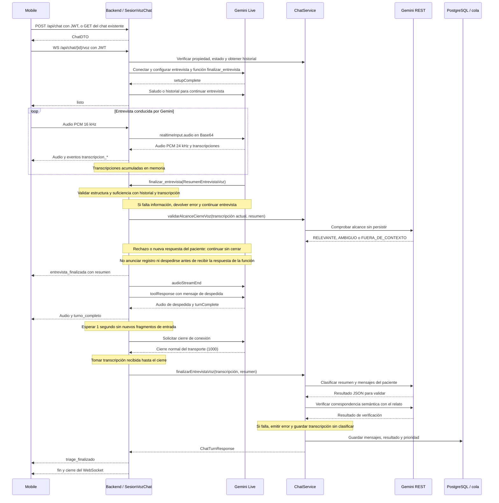

# Chat de voz: mobile, backend y Gemini Live

Texto y voz comparten la [política de preguntas sencillas](17-simple-chat-questions.md):
una pregunta por turno, sin agrupar temas ni leer listas largas. Las correcciones
del backend mantienen ese estilo. El progreso por síntoma y dato decide el cierre,
con una invitación abierta y límites independientes de recursos: 24 turnos totales,
tres intentos por dato y cuatro respuestas seguidas sin avance. Véase
[cierre por datos resueltos](21-cierre-por-datos-resueltos.md).
«No tengo otros síntomas» detiene la búsqueda de síntomas nuevos, pero deja completar
la cuantificación permitida de los ya nombrados; «no quiero seguir» termina la
entrevista. El alcance también incluye malestar emocional; si el relato es emocional,
no se fuerza un interrogatorio de síntomas físicos. Gemini Live genera las preguntas y
el backend aplica el cierre compartido.

Integración de la rama `feature/chat-voz-gemini-live`, actualizada el 11 de octubre de 2026 tras incorporar `desarrollo` en ambos repositorios.

Gemini Live ahora conduce la entrevista directamente por voz: escucha, pregunta y responde con audio. Cuando decide cerrar, entrega un resumen al backend. El backend comprueba el alcance de la entrevista antes de aceptar el cierre. Live no debe anunciar que terminó ni que registró las respuestas antes de recibir la respuesta de `finalizar_entrevista`; si la función devuelve un error, la entrevista sigue abierta. Después de la despedida aceptada, llama a Gemini REST para preclasificar, guarda la transcripción y actualiza la cola. El chat de texto conserva su flujo de preguntas con Gemini REST. Ambos aplican la [política de alcance y evidencia clínica](20-chat-hardening.md).

La versión anterior usaba Gemini para transcribir cada respuesta y leer las preguntas de Ollama. Esa arquitectura quedó reemplazada en voz: ya no existe la función `registrar_respuesta_paciente` ni se emite `turno_bot` por cada respuesta hablada.

## Normalización del lenguaje clínico

La entrevista Live y la clasificación final comparten `LenguajeClinicoChat` con el chat
de texto. El resumen usa ortografía correcta y vocabulario de Argentina; los mensajes
originales siguen guardados tal como llegaron. Por ejemplo, `moratón` se guarda como
`moretón` en el motivo y los síntomas del resultado, conservando la transcripción original.

Gemini debe pedir una explicación neutral ante un término desconocido o ambiguo antes
de tomarlo como un dato clínico, sin adivinar diagnósticos, medicamentos, dosis ni alergias.
Un relato sobre angustia, tristeza, ansiedad, una pérdida o una relación puede ser un
motivo de salud pertinente por sí mismo. Una metáfora como «vacío en el pecho» no se
convierte en dolor torácico ni alarma sin afirmación literal de un síntoma físico. En
esos relatos el bot puede preguntar brevemente qué siente o cómo le afecta, sin exigir
intensidad de dolor, temperatura ni otra cuantificación física. Si también informa
síntomas físicos afirmados, el bot cuantifica esos síntomas según las reglas habituales;
una emoción negada no habilita el flujo emocional.
Si se llega al límite de respuestas o hay una alarma clara, lo que siga sin aclararse se
registra literalmente en observaciones como `termino no aclarado`. La aclaración no
retrasa el cierre por alarma. Negaciones, intensidad, fechas, ubicación y lateralidad
deben conservarse. Un término coloquial comprensible no se considera inventado.
Esto requiere otros hechos clínicos claros que permitan clasificar; si el único
motivo sigue siendo incomprensible, se pide aclaración sin forzar un resultado.

La detección semántica depende del modelo y no garantiza eliminar todos los errores.
La única sustitución local es la variante regional `moratón` y su plural en el resumen;
no modifica la clasificación, no incorpora un fallback y no reescribe chats finalizados.
Más detalles en [AI triage](05-ai-triage.md#clinical-language-normalization).

## Respuesta final incompleta de Gemini REST

La clasificación posterior al cierre de Live exige una respuesta REST completa
(`finishReason=STOP`). El límite de salida REST es configurable con
`GEMINI_MAX_OUTPUT_TOKENS` (8192 por defecto); no cambia el audio ni el modelo Live.
Si falla después del cierre, se conserva la transcripción y el chat queda cerrado,
con `estadoClasificacion=FALLIDA`; no se genera una clasificación local. Puede
reintentarse el procesamiento sin aportar otro mensaje. El log distingue razón de finalización y
contadores de tokens sin exponer el contenido clínico. Véase
[depuración E2E](08-e2e-chat-debugging.md) para las comprobaciones del chat 17.

## Responsabilidades

| Componente | Responsabilidad actual |
| --- | --- |
| Mobile | Capturar y enviar audio, reproducirlo, mostrar transcripciones y distinguir entrevista terminada de clasificación terminada. |
| API HTTP del backend | Crear y consultar el `Chat`; mantener el canal de texto existente. |
| WebSocket del backend | Autenticar al paciente y conectar el canal mobile con Gemini. |
| `SesionVozChat` | Acumular transcripciones, comprobar alcance antes de aceptar el cierre, coordinar la despedida y solicitar la preclasificación con la transcripción completa. |
| Gemini Live | Conducir la entrevista y llamar a `finalizar_entrevista`. El prompt indica que no asigne prioridad. |
| `ChatService` + Gemini REST | Preclasificar el resumen y la transcripción del paciente, validar la salida y rechazarla si no cumple el contrato, sin fallback local. |
| PostgreSQL y servicios de cola | Guardar mensajes, resultado final y prioridad de la consulta. |

Hay dos WebSockets: mobile ↔ backend y backend ↔ Google. La clave `GEMINI_API_KEY` permanece en el servidor. El backend no guarda grabaciones de audio en este flujo.

## Secuencia actual



La consulta mantiene el requisito de selección previa de especialidad y hospital para completar el triage y actualizar la cola. Crear un chat o abrir su canal de voz no realiza esa selección. Ver [flujo del paciente](02-patient-flow.md).

En un chat nuevo, Gemini recibe el saludo inicial como contexto del mensaje que el paciente ya ve. Se le indica no repetirlo: dice «Te escucho» y espera la respuesta. La transcripción de ese primer turno no se envía a mobile ni se agrega otra vez al historial cuando ya existe el saludo, aunque el audio sigue llegando. Si ya hay respuestas, recibe el historial y retoma la siguiente pregunta pendiente sin otro saludo. Durante la conversación el backend no consulta Gemini REST por cada intervención ni persiste cada fragmento: reúne turnos `TurnoVoz` en memoria. `ProgresoEntrevista` evalúa historial previo y turnos pendientes; cuando permite cerrar, la sesión envía un único aviso a Gemini para usar la herramienta. No envía una instrucción adicional en cada turno ni fuerza el cierre por llegar a ocho mensajes.

Los textos dirigidos al paciente no anuncian la preclasificación ni prometen resultados
en pantalla: la despedida es «Gracias. Ya registré tus respuestas para el equipo médico».
Las instrucciones de texto y voz aplican esa misma regla, conservando los avisos de
atención urgente. Ante una falla se informa que no se pudo completar la entrevista y
las respuestas quedan guardadas y puede reintentarse el procesamiento. Mobile muestra «Registrando tus respuestas» y «Tu atención»
en lugar de anunciar el cálculo de prioridad; conserva la información de cola y tiempos.
Los resultados internos para el médico mantienen el mismo contrato.

Verificación del 13 de octubre de 2026: 64 pruebas del backend pasaron con
`./mvnw.cmd "-Dtest=ChatServiceTest,SesionVozChatTest,SesionVozIntegracionTest" test`,
incluida la supresión del saludo fragmentado sin perder las preguntas siguientes.
La recompilación de mobile se realiza desde IntelliJ según la preferencia del usuario.

`finalizar_entrevista` recibe motivo, síntomas, inicio, evolución, dolor, alarmas, antecedentes, medicación, alergias, embarazo y observaciones mediante `ResumenEntrevistaVoz`. No recibe prioridad. El validador compartido exige estructura válida y al menos una respuesta del paciente, y delega la decisión de cierre a `ProgresoEntrevista`. Los datos se vinculan a cada síntoma, con estados respondido, desconocido, rechazado o agotado; las preguntas solo se refieren a síntomas aportados. Agotar un dato no completa otro ni obliga a inventar su valor. «No tengo otros síntomas» impide introducir síntomas nuevos y aún permite completar los reportados; «no quiero seguir» detiene la entrevista. La invitación no se repite y una alarma clara cierra de inmediato. Los presupuestos de 24 turnos, tres intentos por dato y cuatro respuestas sin avance conservan un motivo de cierre parcial. Ante cierre prematuro, la función devuelve el dato pendiente y permite continuar. `ChatService` repite la validación antes de modificar el chat o consultar Gemini REST.

Una vez aceptado el cierre, la sesión detiene el envío de audio del micrófono y envía `audioStreamEnd`. Espera audio o transcripción de la despedida, su `turnComplete` y una ventana de un segundo sin nuevos fragmentos de entrada. Cada fragmento tardío reinicia esa ventana. Después solicita el cierre de Gemini y sigue recibiendo transcripciones hasta la confirmación normal del transporte (`1000`); recién entonces toma la instantánea y clasifica una sola vez. Un cierre normal iniciado por el proveedor también permite completar este paso.

Antes de aceptarlo, `validarAlcanceCierreVoz` consulta Gemini REST con una instantánea
de la entrevista y sin escribir mensajes ni estados. `AMBIGUO` pide aclaración y
`FUERA_DE_CONTEXTO` redirige a salud; ambos conservan abierto el canal. Una nueva
respuesta durante esa comprobación invalida la instantánea para autorizar el cierre.
Los turnos de texto marcados `excluidoDelTriage` permanecen visibles para el paciente,
pero no se entregan a Live ni cuentan para suficiencia, alarmas o límites. El resumen
generado por Live no es evidencia del paciente ni autoriza por sí solo una alarma.

Hay un límite total de 30 segundos desde que se acepta la función, independiente del tiempo posterior de Gemini REST. Si vence, falla la conexión o llega un cierre anormal, se guarda la entrevista cerrada con clasificación `FALLIDA` y se emiten `error` y `fin`; no se clasifica una entrevista con cierre sin confirmar. La ventana reduce la pérdida de fragmentos tardíos, pero no garantiza recuperar texto que Google nunca envíe antes del cierre: `turnComplete` no confirma que haya terminado la transcripción de entrada.

`ChatService.finalizarEntrevistaVoz` guarda la transcripción y cierra la entrevista antes de solicitar la clasificación final a Gemini REST. El prompt indica que, si el resumen contradice al paciente, prevalece la transcripción. Una alarma literal del paciente o una alarma afirmada en el resultado validado exige prioridad al menos 4 y atención inmediata. Cada síntoma o alarma del resultado requiere una cita del paciente y la verificación semántica final; el texto del resumen no basta. Si la respuesta no cumple, pide una corrección sin generar clasificación local. Solo con un resultado válido actualiza `Chat.resultadoTriageJson`, el resumen de la consulta y la prioridad de su entrada en cola. Si el procesamiento falla, las respuestas quedan guardadas en `FALLIDA`.

El chat no genera resúmenes ni prioridades mediante reglas locales. Si Gemini devuelve una clasificación incoherente o JSON/esquema inválido, se solicita una corrección desde el backend. Si sigue fallando, no se guarda un resultado ni se actualiza la prioridad: se emite `error`, se conserva la transcripción y la entrevista queda cerrada en `FALLIDA`, para reintentar solamente el procesamiento. Las validaciones finales son compartidas por texto y voz.

## Contrato de mobile

El endpoint sigue siendo `/api/chat/{id}/voz`. Admite JWT por `Authorization: Bearer` o por `?access_token=` en esta ruta. El detalle de mensajes y rechazos del handshake está en la [referencia de API](06-api-reference.md#voice-chat-gemini-live).

| Evento o mensaje | Acción del cliente |
| --- | --- |
| `listo` | Habilitar envío de audio. Los datos anteriores se descartan. |
| Audio enviado | PCM crudo de 16 bits, mono, little-endian, a 16 kHz; hasta 256 KiB por mensaje binario. El backend no convierte codecs. |
| Audio recibido | Reproducir PCM de 16 bits, mono, little-endian, a 24 kHz. |
| `transcripcion_paciente`, `transcripcion_bot` | Mostrar texto incremental. No son confirmaciones de guardado. |
| `interrumpido` | Interrumpir la reproducción y vaciar el audio pendiente. |
| `turno_completo` | Terminó un turno de Gemini; no equivale a triage finalizado. |
| `entrevista_finalizada` | Detener micrófono y mostrar preclasificación pendiente. El resumen todavía no contiene una prioridad final. |
| `triage_finalizado` | Mostrar `respuesta` y `atencionEstimada`. `origenRespuesta` indica `GEMINI` para nuevas clasificaciones. |
| `fin` o cierre del socket | Terminar la sesión; si falta `triage_finalizado`, consultar el estado del chat por HTTP. |
| `error`, `sesion_por_expirar` | Mostrar el estado y preparar recuperación por texto o una sesión nueva, según el estado persistido. |

El setup de Gemini declara explícitamente detección automática de actividad
(`automaticActivityDetection.disabled=false`) y
`activityHandling=START_OF_ACTIVITY_INTERRUPTS`. No deshabilita las interrupciones
para compensar problemas de eco: el procesamiento acústico corresponde al cliente.
Las sensibilidades y tiempos del VAD mantienen los valores predeterminados del proveedor.

Si llega `interrupted`, el backend envía `interrumpido` antes de reenviar otros
datos de ese mensaje. Descarta el audio y la transcripción de salida del turno
cancelado hasta su `turnComplete`, incluso si esas señales vienen juntas. Conserva
la transcripción de entrada y sigue reenviando el micrófono para que el paciente
pueda continuar; el audio del siguiente turno se procesa normalmente. La parte de
transcripción del bot recibida antes del corte se conserva como texto generado,
sin afirmar que el teléfono haya reproducido todos esos fragmentos: no existe un
acuse de reproducción. Véase el [plan y verificación de interrupciones](16-voice-interruptions.md).

Mobile debe conservar el socket del backend tras `entrevista_finalizada`: el resultado llega después, por `triage_finalizado`. La respuesta final de Gemini REST se entrega como texto; Gemini ya terminó su sesión y no la lee. El cliente debe dejar reproducir el audio de despedida que haya recibido.

### Protección contra eco del parlante en Android

Android configura una sesión de comunicación para capturar y reproducir voz y
activa `AcousticEchoCanceler` cuando puede habilitarlo. El modo efectivo se expone
como `AudioVoz.modoEntrada`: `INTERRUMPIBLE` permite enviar la voz del paciente
mientras habla el asistente; `POR_TURNOS` protege contra eco cuando no están las
condiciones de audio necesarias. La pantalla sigue ese estado; la selección es
automática y no expone un control manual de eco. La capacidad nativa no demuestra por
sí sola que el teléfono elimine todo el eco: requiere validación física.

En modo por turnos, las lecturas del micrófono se reemplazan por PCM silencioso
mientras hay audio del bot en la cola o en el buffer nativo. La captura continúa
para descartar ese sonido. El flujo PCM sigue abierto; no se envía `fin_audio`
por cada fragmento silenciado.

La escucha vuelve cuando `AudioTrack.playbackHeadPosition` alcanza todos los frames
encolados y pasan 300 ms de margen para el eco residual. Se verifica antes y después
de leer cada fragmento. `turno_completo` confirma generación remota, pero no asegura
que el parlante ya haya terminado; por eso no libera esta protección. Las escrituras
nativas son no bloqueantes, manejan escrituras parciales y se invalidan por generación
al interrumpir, para impedir que un fragmento previo vuelva después del vaciado.

El modo interrumpible usa la cancelación de eco y las rutas de comunicación;
el modo protegido requiere esperar el final de la respuesta. El volumen y la ruta
siguen la sesión de comunicación de Android, no el canal multimedia previo.
No cambia el protocolo WebSocket ni las reglas de clasificación del backend.
El [plan de interrupciones](16-voice-interruptions.md) describe los criterios de
aceptación y la validación. El efecto acústico final requiere probar el APK en un
teléfono real, con parlante, auriculares y distintos volúmenes.

`{"tipo":"fin_audio"}` indica pausa del micrófono y se traduce a `audioStreamEnd`. `{"tipo":"cerrar"}` cierra el canal. Antes de finalizar la entrevista, el backend intenta guardar lo acumulado sin clasificar; después de aceptar el cierre de Gemini, la clasificación pendiente continúa aunque mobile se desconecte. No enviar las transcripciones nuevamente por el endpoint de texto: se duplicarían.

## Persistencia y recuperación

El guardado de una sesión interrumpida es asíncrono. El cierre del socket no confirma que la transcripción ya esté disponible para una reconexión inmediata. Si falla la clasificación después de aceptar el cierre, se conserva la entrevista cerrada y `estadoClasificacion=FALLIDA`; `registrarCierreVozFallido` evita duplicar turnos. Mobile bloquea nuevas respuestas y ofrece «Reintentar», que llama `POST /api/chat/{id}/clasificacion` sin enviar un «ok». No hay reanudación de sesión de Google ni coordinación global entre envíos por HTTP y WebSocket.

`fin` también puede representar una desconexión de Gemini sin entrevista completa. Para conocer el estado persistido se usa `GET /api/chat/{id}`; para el estado de atención se conserva el flujo de consulta y cola. Si el proceso del backend termina abruptamente durante la entrevista, los turnos que solo estaban en memoria todavía no se guardaron.

## Cierre y criterios compartidos, 13 de octubre de 2026

`finalizado=true` significa que la entrevista terminó; el nuevo campo
`estadoClasificacion` distingue `NO_SOLICITADA`, `PENDIENTE`, `COMPLETADA` y `FALLIDA`.
Después de aceptar el cierre, ningún fallo de clasificación vuelve a habilitar
preguntas. Se guarda la transcripción una vez, sin resultado inventado ni actualización
de prioridad en la cola. Una interrupción antes de aceptar el cierre todavía permite
continuar la entrevista; una interrupción del transporte después del cierre marca fallo.

Texto y voz comparten la validación final: estructura válida, prioridad 1–5,
coherencia entre alarma afirmada y prioridad >=4/atención inmediata, y ausencia de
negaciones como «Ninguna» en listas de alergias, medicamentos y antecedentes.
El resumen Live guía la extracción, sin imponer un umbral independiente de prioridad.
Ante un resultado incoherente se solicita una corrección a Gemini con el tiempo
restante de 45 segundos. Si sigue fallando, la entrevista queda cerrada en `FALLIDA`.
Los errores de JSON/esquema del resultado final también pueden pedir esa única corrección. Los errores transitorios REST tienen [reintentos automáticos acotados](19-gemini-retries.md): dos intentos HTTP por invocación de Gemini por defecto, dentro del presupuesto compartido de 45 segundos. Un 429 solo se repite con `Retry-After` válido. No se reconecta Live ni se reproduce de nuevo el audio automáticamente.

Mobile lee ese estado y ofrece «Reintentar» mediante
`POST /api/chat/{id}/clasificacion`, sin enviar un «ok» ni repetir respuestas. Solo
puede procesarse el último chat propio fallido, con bloqueo de fila para serializar
reintentos. Los completados e históricos no se vuelven a clasificar por este endpoint.
Esta política reemplaza el comportamiento histórico que dejaba abierto el chat
tras fallar la clasificación. El fallback de recepción sigue existiendo.

La verificación real simuló una primera respuesta incoherente y llamó a Gemini
para corregirla: obtuvo un resultado completo con prioridad 5 y atención inmediata,
alergias vacías y un solo mensaje del paciente. Se usaron repositorios simulados,
sin modificar datos de pacientes. Mobile requiere recompilación desde IntelliJ.
Las pruebas completas se ejecutan con `python scripts/test_backend_isolated.py`.

## Regresiones y verificación

Los casos que antes verificaban fallback de chat ahora verifican rechazo sin resultado local. Se conservan los escenarios de contradicciones, negaciones, dolor e inicio; la transcripción se guarda una sola vez tras fallar la clasificación de voz. El formulario de recepción sigue teniendo fallback. Las cifras y pruebas de proveedor del 29 de septiembre y 11 de octubre que siguen son verificaciones históricas.

Las pruebas versionadas cubren los tres defectos observados en la revisión inicial:

| Defecto | Comportamiento verificado |
| --- | --- |
| Resumen contradice la transcripción y Gemini falla | Se conservan los turnos literales para continuar; no se genera un resumen ni una prioridad local. |
| Cierre sin información suficiente | `{}` se rechaza sin consultar Gemini REST ni guardar una clasificación; la entrevista puede continuar y finalizar luego con información suficiente. |
| Transcripción tardía descartada | Se aceptan fragmentos después de `turnComplete` y hasta confirmar el cierre; se reinicia la ventana de drenaje y se clasifica una vez. También se prueban timeout, cierre anormal, callbacks duplicados y desconexión de mobile. |

`SesionVozIntegracionTest` combina la sesión, el validador y `ChatService` reales con repositorios y proveedores simulados. `SesionVozChatTest` usa un reloj controlado para comprobar vencimientos sin pausas de tiempo real. Estas pruebas no cubren el micrófono ni la reproducción de mobile. Las verificaciones reales del proveedor se describen a continuación. Los comandos reproducibles están en [desarrollo local](07-local-development.md#voice-chat-regression-tests).

Verificación del 29 de septiembre de 2026: **82 pruebas focalizadas**, **310 pruebas Java en la suite completa** y **11 pruebas Python**, sin fallos. La suite completa usó PostgreSQL en una base aislada; las 82 focalizadas forman parte de las 310. Los contextos de aplicación arrancan con servidor en puerto aleatorio y verifican el contenedor WebSocket y sus límites.

Verificación real del proveedor el 11 de octubre de 2026: la clave del `.env`
local autenticó correctamente una consulta REST y una conexión WebSocket a
Gemini Live. `models/gemini-3.8-live` aceptó el setup con audio, voz `Kore`, idioma
`es-US`, transcripciones y una función de prueba. Ejecutó esa función, recibió
su respuesta y generó 71.042 bytes de audio. Se usó solamente un mensaje técnico
ficticio, sin datos de pacientes. No apareció un rechazo por facturación o cuota
en esa sesión; esto no verifica el nivel de facturación de la cuenta ni garantiza
capacidad para mayor volumen. La captura de micrófono, la reproducción en mobile
y el flujo completo de preclasificación por voz siguen pendientes de una prueba
real conjunta. La clave permanece en el `.env` ignorado por Git.

El checkout mobile `pretriage_frontend_mobile` incorporó el cliente de voz en `246f815` y recibió los cambios de `desarrollo` en `84f08b4`. Incluye el canal WebSocket y manejo de eventos de voz. La compilación Android y la prueba de micrófono/reproducción quedan a cargo del usuario desde IntelliJ.

## Referencias y configuración

### Android Emulator: Gemini habla pero no escucha

El permiso Android `RECORD_AUDIO` no habilita por sí solo el micrófono de la PC.
Android Emulator desactiva la entrada de audio del host por defecto. Abrir los
controles extendidos del emulador y, en **Microphone**, activar **Virtual microphone
uses host audio input**. Windows también debe permitir acceso al micrófono para
aplicaciones de escritorio. Ver [controles extendidos oficiales](https://developer.android.com/studio/run/emulator-extended-controls#microphone).

Con un solo emulador conectado, también puede habilitarse para la sesión actual:

```powershell
adb emu avd hostmicon
```

Detener y volver a iniciar la voz dentro del chat; no requiere recompilar ni
reiniciar el backend. Comprobar que hablar genera `transcripcion_paciente`.
El comando `OK` solo confirma que el emulador aceptó habilitar la entrada; no
comprueba que el micrófono físico esté entregando señal. Si sigue sin transcribir,
revisar el dispositivo de entrada seleccionado en Windows y los controles del
emulador antes de atribuir el fallo al proveedor o modificar el protocolo.

- [SesionVozChat](../src/main/java/com/pretriage/backend/services/voz/SesionVozChat.java): entrevista, transcripciones, función de cierre y eventos.
- [ChatService](../src/main/java/com/pretriage/backend/services/ChatService.java): clasificación con Gemini, validación y persistencia.
- [ChatVozHandshakeInterceptor](../src/main/java/com/pretriage/backend/controllers/ChatVozHandshakeInterceptor.java) y [ChatVozWebSocketHandler](../src/main/java/com/pretriage/backend/controllers/ChatVozWebSocketHandler.java): autorización y canal cliente.
- [GeminiLiveCliente](../src/main/java/com/pretriage/backend/services/voz/GeminiLiveCliente.java): conexión con Google.
- [Configuración local](07-local-development.md): `GEMINI_API_KEY`, modelo, voz, idioma y orígenes. El modelo por defecto es `models/gemini-3.8-live`; una configuración no vacía no comprueba su disponibilidad real.
- [Referencia oficial de Gemini Live](https://ai.google.dev/api/live): protocolo y ausencia de orden garantizado para `inputTranscription`.

## Migración del 11 de octubre de 2026

Texto, clasificación final de voz y formularios de recepción usan `GeminiJsonClient` con JSON Schema. `GEMINI_CHAT_MODEL` configura el modelo REST; `GEMINI_LIVE_MODEL` configura el modelo de audio. Ambos usan `GEMINI_API_KEY`, guardada únicamente en el backend. La entrevista de voz sigue usando Live y su clasificación final usa REST. No se requiere Ollama.

Registro histórico del cambio del 21 de octubre de 2026: texto y voz dejaron de exigir cubrir temas fijos y adoptaron una invitación abierta y un límite de ocho respuestas. Esa descripción fue sustituida por la política vigente de cuantificación de síntomas ya enumerados, documentada al inicio de esta guía y en [entrevista y cuantificación](17-simple-chat-questions.md). Los turnos intermedios de texto entonces usaban solo `mensaje`; desde el endurecimiento del 25 de octubre también devuelven `estadoEntrada` y se verifica el alcance de las respuestas relevantes. Una pregunta inválida o repetida admite una corrección remota. El backend decide cuándo pedir la clasificación final y conserva sus validaciones de estructura y alarmas. Las llamadas REST usan la política de [reintentos acotados](19-gemini-retries.md), sin ampliar el presupuesto de 45 segundos por operación ni reenviar mensajes desde mobile.

Verificación del cambio del 12 de octubre de 2026: **366 pruebas Java** en una base PostgreSQL aislada y **12 pruebas Python**, sin fallos. Se conservaron los 38 escenarios existentes de `ChatServiceTest`, adaptando las expectativas del fallback retirado. Las pruebas con transacciones reales verifican que fallar Gemini no persiste el mensaje de texto ni una clasificación; reintentar no duplica el historial. En voz se guarda la transcripción una sola vez tras el error. Una regresión de recepción comprueba que fallar Gemini todavía activa `resultadoFallback` y completa la admisión.

Verificación posterior de cierre prematuro: **373 pruebas Java** completas, sin fallos, usando otra base aislada. Incluyen el reconocimiento de «anoche», el esquema de continuación, los límites de tiempo y la persistencia de una sola respuesta corregida. Una comprobación sintética forzó el primer cierre prematuro y ejecutó la corrección contra Gemini REST real: recibió una pregunta y conservó el chat abierto con origen `GEMINI` en aproximadamente 2,3 segundos. Los repositorios y la primera respuesta fueron simulados; no se modificó el chat real del usuario.

Verificación de la migración: **362 pruebas Java** en PostgreSQL aislado y **12 pruebas Python**, sin fallos. Dos E2E reales contra el backend temporal en `localhost:18080` y Gemini REST guardaron origen `GEMINI`: el caso de fiebre/dolor de garganta cerró en cuatro respuestas y el de dolor de pecho/dificultad respiratoria cerró en una respuesta con prioridad 5 y aviso urgente. Se comprobó el vínculo `ConsultaMedica.chat`, el estado `EN_COLA` y la concordancia de prioridad en resultado, consulta y entrada de cola.

También se ejecutó `ChatService.finalizarEntrevistaVoz` con Gemini REST real y una transcripción sintética de cefalea/fiebre: cerró con origen `GEMINI`, conservó dolor 8/10 y respondió en aproximadamente 2,3 segundos. Los repositorios y el servicio de cola fueron simulados en esa comprobación; no constituye una prueba completa del micrófono, los dos WebSockets y la persistencia. Los tiempos son observaciones de estas ejecuciones, no garantías de rendimiento.

## Corrección del contrato de continuación, 13 de octubre de 2026

El error `continuation_required` se producía cuando la corrección seguía recibiendo
un objeto de clasificación con `finalizado=true`. Ahora esa petición tiene un
prompt exclusivo para escribir una pregunta y un JSON Schema con un único campo
`mensaje`. No se envían las instrucciones de clasificación del prompt normal.
La pregunta procede de Gemini; el backend controla que ese turno siga abierto,
sin generar hechos clínicos ni prioridades locales. La corrección conserva el
límite de una consulta adicional y el presupuesto restante de 45 segundos.

El caso de moratón en rodilla mostró también una omisión en el vocabulario del
validador. Se agregaron síntomas traumáticos y se probaron sus negaciones breves
y el inicio/evolución. Las preguntas del entrevistador se incluyen en la entrada
de clasificación como contexto, sin tratarlas como afirmaciones del paciente.

La corrección fue comprobada contra Gemini REST real con una entrevista sintética:
devolvió la pregunta y mantuvo el chat abierto con origen `GEMINI` en unos 2 segundos.
La primera respuesta y los repositorios fueron simulados; no se modificó el chat
del usuario. La suite completa pasó 379 pruebas Java usando PostgreSQL aislado.

## Verificación del 25 de octubre de 2026

La suite aislada ejecutó **571 pruebas**, con **4 pruebas opt-in de Gemini omitidas** y
cero fallos o errores. Las regresiones verifican que Live espere la respuesta de
`finalizar_entrevista` antes de anunciar registro o despedirse, y que un motivo
emocional no omita la cuantificación de síntomas físicos afirmados. La desconexión
esperada de SSE termina sin enviar un cuerpo JSON de error. Estas pruebas usan
proveedores simulados; no validan audio Live real ni el comportamiento acústico del
micrófono y parlante.
