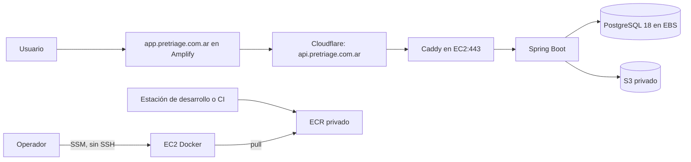

# Despliegue de demo temporal en AWS

Esta guía describe cómo desplegar el backend para una demo bajo demanda. El stack
de CloudFormation crea un host EC2 con Docker, un bucket privado de S3 y un
repositorio privado de ECR. El frontend Next.js sigue en Amplify; Cloudflare
publica los nombres y protege el origen del backend. No se crean recursos AWS al
leer esta guía.

La instalación es una demo de un solo host para datos sintéticos.



## Antes de desplegar

1. Confirmá la región asignada en **AWS Settings → View all projects → Overview → Additional Info → Region**. La configuración que se revisó para este proyecto apunta a `us-east-1`, pero la región asignada manda. Si no podés confirmarla allí, compará `aws configure get region --profile <perfil>` con la configuración del proyecto antes de seguir. No despliegues en una región distinta.
2. El estado consultado el 31/10/2026 indicaba plan **Paid** y `FreeTierAPI=0`; los créditos promocionales no se verificaron. Revisá **AWS Settings → Billing** antes de crear recursos y confirmá que el límite de gasto del proyecto sea adecuado.
3. Necesitás AWS CLI v2, una sesión autenticada para un perfil con permiso de crear el stack, construir o publicar imágenes en ECR y administrar la instancia. La plantilla solo da permisos de lectura de ECR al rol de EC2; no concede permisos ECR a personas.
4. Necesitás un VPC existente y una subnet pública de ese VPC con ruta `0.0.0.0/0` hacia un Internet Gateway. El inventario actual encontró un VPC default y una subnet pública; confirmá los IDs y que correspondan a la región asignada. La plantilla reserva y asocia una Elastic IP para conservar la IPv4 pública entre paradas e inicios.
5. El dominio `pretriage.com.ar` debe estar activo en Cloudflare. La plantilla incluye las 15 redes IPv4 publicadas por Cloudflare en la lista consultada. Revisá la lista oficial antes de desplegar y mantenela actualizada: [rangos IPv4 de Cloudflare](https://www.cloudflare.com/ips-v4/).
6. Tené disponible Auth0 y las claves que realmente se usarán. Gemini y Google Maps son opcionales para iniciar el backend, pero sus funciones necesitan las claves de esos proveedores. No pegues secretos en comandos, argumentos, el repositorio ni en la imagen Docker.

## Costos para planificar

La plantilla usa `t3a.medium` (2 vCPU, 4 GiB) con CPU credit mode `standard`, una raíz EBS cifrada gp3 de 24 GiB y una Elastic IP asociada que conserva el DNS al detener EC2. No crea NAT Gateway ni balanceador. La IPv4 reservada genera cargos aun cuando EC2 está detenida.

Precios públicos consultados el 31/10/2026 para `us-east-1`:

| Recurso | Referencia usada | Ejemplo |
| --- | --- | --- |
| EC2 `t3a.medium` Linux | [Precios T3 de AWS](https://aws.amazon.com/ec2/instance-types/t3/) | USD 0,0376 por hora activa |
| Elastic IP / IPv4 pública reservada | [Precios de VPC](https://aws.amazon.com/vpc/pricing/) | USD 0,005 por hora; aproximadamente USD 3,65 por 730 horas, incluso con EC2 detenida |
| EBS gp3 | [Precios de EBS](https://aws.amazon.com/ebs/pricing/) | USD 0,08/GiB-mes; 24 GiB ≈ USD 1,92/mes |
| S3 Standard | [Precios de S3](https://aws.amazon.com/s3/pricing/) | Primer nivel: alrededor de USD 0,023/GB-mes, más solicitudes y versiones |
| ECR privado | [Precios de ECR](https://aws.amazon.com/ecr/pricing/) | Almacenamiento alrededor de USD 0,10/GB-mes; transferencia a EC2 en la misma región no tiene cargo |
| Amplify con SSR | [Precios de Amplify](https://aws.amazon.com/amplify/pricing/) | Puede sumar builds, transferencia, solicitudes y duración SSR según uso |

Con esos valores, 100 horas de instancia, Elastic IP reservada durante 730 horas
y 30 días de volumen suman aproximadamente **USD 9,33** (3,76 + 3,65 + 1,92).
Si queda activa las 730 horas del mes de referencia, la estimación es
aproximadamente **USD 33,02** (27,45 + 3,65 + 1,92). Son
referencias, no una cotización. No incluyen S3 y sus versiones/solicitudes,
almacenamiento de ECR, transferencia, Amplify y sus solicitudes/duración SSR, Cloudflare, Gemini, Google Maps,
impuestos ni descuentos/créditos. La raíz EBS, S3 versionado y las imágenes ECR
siguen almacenados y pueden seguir cobrando cuando EC2 está detenido. Consultá
los precios actuales para la región asignada antes de desplegar.

## 1. Autenticarse y elegir la región

En PowerShell, reemplazá el perfil por el nombre configurado en AWS CLI. `aws
login` inicia la sesión; `sts get-caller-identity` comprueba qué identidad usará
la terminal.

```powershell
$awsProfile = 'tu-perfil'
$awsRegion = 'us-east-1' # Cambialo solo si confirmaste otra región asignada.
aws login --region $awsRegion --profile $awsProfile
aws sts get-caller-identity --profile $awsProfile --region $awsRegion --no-cli-pager
```

Si la región confirmada no es `us-east-1`, también declarala para que el helper
no use su protección predeterminada:

```powershell
$env:PRETRIAGE_CONFIRMED_AWS_REGION = $awsRegion
```

El helper de arranque y parada consulta el nombre de stack `pretriage-demo` por
defecto. Conservá ese nombre durante este procedimiento o pasá `-StackName` en
cada llamada.

## 2. Crear el stack de infraestructura

Revisá en la consola de VPC el VPC y la subnet pública que vas a usar. La subnet
debe estar en el VPC elegido, en la misma región y tener una ruta por Internet
Gateway; no uses una subnet privada sin NAT. No hace falta crear ni reemplazar
el VPC o su subnet.

Validá y desplegá la plantilla desde la raíz del repositorio:

```powershell
$vpcId = Read-Host 'ID del VPC existente'
$publicSubnetId = Read-Host 'ID de la subnet pública del mismo VPC'

aws cloudformation validate-template `
  --template-body file://infra/aws/demo-stack.yaml `
  --profile $awsProfile --region $awsRegion --no-cli-pager

aws cloudformation deploy `
  --template-file infra/aws/demo-stack.yaml `
  --stack-name pretriage-demo `
  --capabilities CAPABILITY_IAM `
  --parameter-overrides "VpcId=$vpcId" "PublicSubnetId=$publicSubnetId" `
  --profile $awsProfile --region $awsRegion
```

La plantilla ya se validó localmente con `cfn-lint` 1.59.0. `validate-template`
es una comprobación de CloudFormation, no crea el stack. `deploy` sí crea
recursos y puede incurrir en cargos. La instancia se inicia al crear el stack.
La plantilla instala Docker, habilita el daemon y prepara directorios; no inicia
servicios de Pretriage.

Mostrá las salidas del stack y guardá los valores de la instancia, bucket y ECR:

```powershell
aws cloudformation describe-stacks `
  --stack-name pretriage-demo `
  --query 'Stacks[0].Outputs[].[OutputKey,OutputValue]' `
  --output table --profile $awsProfile --region $awsRegion
```

La instancia no tiene SSH. La salida `SsmStartSessionCommand` muestra el comando
de conexión; también podés ejecutar:

```powershell
aws ssm start-session --target <InstanceId> --profile $awsProfile --region $awsRegion
```

Si no puede iniciar la sesión, revisá que la instancia esté en `running`, que
el agente de SSM esté conectado y que la identidad de operador tenga permiso de
abrir una sesión. No abras el puerto 22.

## 3. Construir y publicar la imagen del backend

La imagen se compila en la estación de desarrollo o CI, no en EC2. La imagen
final es Linux `amd64` para coincidir con la AMI `x86_64`. La prueba de humo
local usa un PostgreSQL descartable y no requiere credenciales AWS:

```powershell
python scripts/test_aws_container.py --build
```

Obtené el `BackendImageRepositoryUri` entre las salidas de CloudFormation. El
operador que publica necesita permisos ECR de carga además de los permisos de
despliegue del stack. Usá una etiqueta nueva para cada compilación; el repositorio
conserva como máximo las tres imágenes más recientes.

```powershell
$repositoryUri = '<BackendImageRepositoryUri de las salidas del stack>'
$registry = $repositoryUri.Split('/')[0]
$imageTag = "demo-$(Get-Date -Format yyyyMMddHHmmss)"

aws ecr get-login-password --region $awsRegion --profile $awsProfile |
  docker login --username AWS --password-stdin $registry

docker buildx build `
  --platform linux/amd64 `
  --tag "$($repositoryUri):$imageTag" `
  --push .
```

`docker login` recibe el token por stdin; no lo copies en un argumento ni lo
guardes en el repositorio. Reemplazá el URI de ejemplo por la salida real. El
rol de EC2 solo puede descargar imágenes desde este repositorio; el token ECR
vence y no hace falta volver a iniciar sesión para arrancar una imagen ya
descargada.

## 4. Preparar los archivos en EC2

Conectate por SSM y abrí una sesión de root:

```bash
sudo -i
cd /opt/pretriage
```

El bootstrap creó `/opt/pretriage/data/postgres` como directorio de datos nuevo
para PostgreSQL 18, propiedad del UID 999. Esta opción despliega una base nueva;
no importa, migra ni restaura una base o volcado existente. **No la reemplaces
con el volumen de desarrollo.** La ruta que monta Compose es
`/opt/pretriage/data/postgres:/var/lib/postgresql`.

Copiá el contenido de estos archivos del repositorio en los destinos indicados.
La sesión SSM es interactiva: con `vi`, abrí el archivo, presioná `i`, pegá el
contenido, y guardá con `Esc`, `:wq`, `Enter`. Antes de pegar secretos o la
clave TLS, verificá que no haya grabación de transcripciones de SSM habilitada
para esta sesión; la plantilla no configura esa grabación.

| Archivo del repositorio | Destino en EC2 |
| --- | --- |
| `compose.aws.yaml` | `/opt/pretriage/compose.aws.yaml` |
| `infra/aws/Caddyfile` | `/opt/pretriage/Caddyfile` |
| `infra/aws/.env.aws.example` (completar con valores reales) | `/opt/pretriage/.env.aws` |

Creá los archivos no secretos así:

```bash
vi /opt/pretriage/compose.aws.yaml
vi /opt/pretriage/Caddyfile
```

Creá `.env.aws` desde la estructura de `infra/aws/.env.aws.example`. Completá
los valores necesarios en el editor, no en argumentos de shell. No copies el
archivo rellenado al repositorio ni a la imagen Docker.

```bash
install -o root -g root -m 0600 /dev/null /opt/pretriage/.env.aws
vi /opt/pretriage/.env.aws
chmod 0600 /opt/pretriage/.env.aws
```

Usá la salida `BackendImageRepositoryUri` y la etiqueta recién publicada para
`BACKEND_IMAGE`, y las salidas del stack para `AWS_S3_BUCKET_NAME`. Configurá
`AWS_REGION` y `AWS_S3_REGION` con la región confirmada. `POSTGRES_PASSWORD`
debe ser único y aleatorio, no el valor de ejemplo. Configurá Auth0 con el
issuer exacto y las credenciales correspondientes. Para la demo web, los valores
de origen deben coincidir exactamente:

```text
PRETRIAGE_FRONTEND_BASE_URL=https://app.pretriage.com.ar
PRETRIAGE_VOZ_ORIGENES=https://app.pretriage.com.ar
PRETRIAGE_CORS_ALLOWED_ORIGINS=https://app.pretriage.com.ar
```

No agregues claves de AWS: el SDK de backend obtiene credenciales del perfil de
instancia IMDSv2. Gemini y Google Maps se pueden completar si la demo necesita
esas funciones. SMTP puede quedar en modo `local` solo con identidades
sintéticas; en ese modo los enlaces de invitación y recuperación quedan en los
logs de la aplicación.

### Certificado TLS del origen

En Cloudflare, generá un certificado **Origin CA** para
`api.pretriage.com.ar`, guardá el certificado y su clave privada en un
administrador de secretos local y configurá el registro DNS `api` como
**Proxied**. En **SSL/TLS**, elegí **Full (strict)**. La plantilla no abre el
puerto 80 ni usa ACME: Cloudflare finaliza TLS público y Caddy termina el TLS
entre el proxy y EC2 con el certificado Origin CA.

El directorio del host `/opt/pretriage/certs` ya existe y está en modo 0700.
Pegá el certificado en `origin.pem` y la clave en `origin-key.pem` desde el
editor de la sesión SSM; no pongas la clave en un comando ni la imprimas:

```bash
vi /opt/pretriage/certs/origin.pem
vi /opt/pretriage/certs/origin-key.pem
chown root:root /opt/pretriage/certs/origin.pem /opt/pretriage/certs/origin-key.pem
chmod 0600 /opt/pretriage/certs/origin-key.pem
chmod 0644 /opt/pretriage/certs/origin.pem
```

El Compose monta el directorio de certificados de solo lectura en Caddy. No
expongas el origen sin Cloudflare: la regla de seguridad permite TCP/443 solo
desde la lista de prefijos IPv4 de Cloudflare.

## 5. Configurar Cloudflare y Amplify

1. En Cloudflare, creá o actualizá un único registro A `api.pretriage.com.ar` con la Elastic IP asignada a la instancia y dejalo **Proxied**. El helper solo actualiza un registro A existente y exige que haya exactamente uno. La Elastic IP se informa al completar el stack; no copies una IP de una sesión anterior.
2. Publicá los cambios locales del repositorio web en la rama que conectes a Amplify. El checkout revisado usa `desarrollo`; no asumir que GitHub contiene los cambios locales sin publicar. `pretriage_frontend_web/package.json` fija Next.js **15.5.28** y `pretriage_frontend_web/amplify.yml` usa Node 22, `npm ci`, `BACKEND_API_URL` y artefactos `.next`. Es Amplify Hosting para SSR; no se agrega un backend Amplify Gen 2.
   Amplify está configurado con `Pretriage/pretriage_frontend_web`, la rama `desarrollo` y Hosting compute (`WEB_COMPUTE`), con el rol de servicio de SSR de la consola. El frontend llama por HTTPS a Spring Boot; no necesita permisos sobre el bucket clínico ni un rol de despliegue de Amplify Gen 2. [Despliegue de Next.js SSR](https://docs.aws.amazon.com/amplify/latest/userguide/deploy-nextjs-app.html).
3. En los ajustes de variables de entorno de la rama de Amplify que se va a publicar, definí `BACKEND_API_URL=https://api.pretriage.com.ar`. Es una URL del backend, no una clave secreta; el código la consume en rutas/funciones de servidor. El `.env.example` local usa `http://localhost:8080` solo para desarrollo.
4. El dominio personalizado actual de Amplify es `app.pretriage.com.ar`, vinculado a `desarrollo`. Sus CNAME de aplicación y validación están configurados en Cloudflare como **DNS only**. El hostname respondió HTTP 200 con TLS válido y Amplify informa `AVAILABLE`. No agregues redirecciones ni alias no elegidos. La URL por defecto de Amplify también permanece disponible.
5. El frontend y el backend deben coincidir en los orígenes CORS y WebSocket. El backend usa `PRETRIAGE_CORS_ALLOWED_ORIGINS` para HTTP y `PRETRIAGE_VOZ_ORIGENES` para `/api/chat/{id}/voz`; voz usa `wss://` en el sitio publicado. Caddy reenvía el upgrade WebSocket y descarga SSE inmediatamente.

Si el A de `api` aún no existe, crealo manualmente después del despliegue inicial.
Para los siguientes arranques, el helper puede actualizarlo por API de
Cloudflare. El token debe tener permiso DNS Edit limitado a la zona
`pretriage.com.ar`; el Zone ID no es secreto. El helper no imprime respuestas de
error de Cloudflare para evitar filtrar datos de la sesión.

## 6. Descargar las imágenes e iniciar el servicio

En la sesión SSM, completá el inicio de sesión ECR usando el rol de EC2. Sustituí
`<REGION>` y `<REGISTRO_ECR>` por la región confirmada y el prefijo del URI de
ECR (la parte anterior a `/repositorio`). `DOCKER_CONFIG` apunta a almacenamiento
temporal bajo `/run`; el token no queda en un archivo persistente.

```bash
export DOCKER_CONFIG="$(mktemp -d /run/pretriage-ecr.XXXXXX)"
aws ecr get-login-password --region <REGION> |
  docker login --username AWS --password-stdin <REGISTRO_ECR>
docker compose --env-file .env.aws -f compose.aws.yaml pull
docker logout <REGISTRO_ECR>
rm -rf "$DOCKER_CONFIG"
unset DOCKER_CONFIG
```

Copiá el unit file `infra/aws/pretriage.service` a
`/etc/systemd/system/pretriage.service` usando `vi` o un mecanismo seguro. El
unit ejecuta `docker compose up -d --wait` al iniciar el host y para los
contenedores de forma ordenada durante el apagado. Habilitalo e iniciá la demo:

```bash
vi /etc/systemd/system/pretriage.service
systemctl daemon-reload
systemctl enable --now pretriage
systemctl status pretriage --no-pager
docker compose --env-file .env.aws -f compose.aws.yaml ps
docker compose --env-file .env.aws -f compose.aws.yaml logs --tail=100 postgres backend caddy
```

Los límites de Compose reservan hasta 2 GiB para backend, 768 MiB para
PostgreSQL y 128 MiB para Caddy. En el host de 4 GiB quedan alrededor de 1,1 GiB
para el sistema operativo, Docker y picos; la carga de una demo debe ser baja.
La construcción de la imagen debe quedarse fuera de EC2.

Desde una terminal local, comprobá readiness a través del dominio público:

```powershell
curl.exe --fail https://api.pretriage.com.ar/actuator/health/readiness
```

El endpoint de health no muestra detalles internos. Por ahora validá el build
de Amplify y el health/readiness por HTTPS. Las pruebas autenticadas y los flujos
completos de personal quedan diferidos hasta cargar usuarios y datos de
hospital.

El perfil AWS conserva esquema y datos mediante `JPA_DDL_AUTO=update`. El primer
arranque conserva los inicializadores existentes de especialidades globales y
el rol coordinador; este despliegue no los modifica. La carga de datos restantes
queda diferida hasta que se retome expresamente: no migres ni restaures datos
existentes, ni ejecutes scripts de seed durante esta instalación. En particular,
esta base nueva no recibe un usuario global `ADMIN`, hospitales ni personal
clínico. Sin esos datos no se pueden completar los flujos administrativos y de
atención, y no hay una API para crear el primer administrador global. La
incorporación de ese usuario y del conjunto de demo queda para una continuación
posterior. La estrategia de migraciones todavía no es una base para producción;
revisá [el perfil backend AWS](27-aws-backend-runtime.md).

## 7. Operar la demo

Desde la raíz del repositorio, el helper `scripts/aws-demo.ps1` consulta el
stack y espera a que EC2 quede lista. No detiene ni inicia la base mediante un
`docker compose stop` manual; el unit systemd se ocupa del apagado y de arrancar
los servicios en el siguiente boot.

```powershell
.\scripts\aws-demo.ps1 -Action status -Profile $awsProfile -Region $awsRegion
.\scripts\aws-demo.ps1 -Action start -Profile $awsProfile -Region $awsRegion
.\scripts\aws-demo.ps1 -Action stop -Profile $awsProfile -Region $awsRegion
```

Detenela cuando termine la demo. `stop` conserva el sistema de archivos, la
base y la Elastic IP asociada. EC2 deja de cobrar cómputo mientras está detenida,
pero el volumen EBS y la Elastic IP reservada siguen facturándose. Al volver a
`start`, la dirección se conserva y el registro A de Cloudflare no necesita
cambios.

Si fuera necesario corregir manualmente el A existente, el helper puede
actualizarlo al iniciar, aunque no hace falta en los ciclos normales de
stop/start con la Elastic IP. Cargá el
token de Cloudflare en memoria desde el almacén seguro local; no lo escribas en
la línea de comando ni en el historial de PowerShell. El script necesita además
`CLOUDFLARE_ZONE_ID` y cambia el registro a proxied con TTL automático:

```powershell
$secureToken = Read-Host 'Token API de Cloudflare' -AsSecureString
$tokenPointer = [Runtime.InteropServices.Marshal]::SecureStringToBSTR($secureToken)
try {
    $env:CLOUDFLARE_API_TOKEN = [Runtime.InteropServices.Marshal]::PtrToStringBSTR($tokenPointer)
} finally {
    [Runtime.InteropServices.Marshal]::ZeroFreeBSTR($tokenPointer)
}
$env:CLOUDFLARE_ZONE_ID = Read-Host 'Zone ID de pretriage.com.ar'
try {
    .\scripts\aws-demo.ps1 -Action start -Profile $awsProfile -Region $awsRegion -UpdateCloudflareDns
} finally {
    Remove-Item Env:CLOUDFLARE_API_TOKEN, Env:CLOUDFLARE_ZONE_ID -ErrorAction SilentlyContinue
}
```

Si el inicio falla después de arrancar EC2, resolvé primero la causa y detené
la instancia para limitar cargos:

```powershell
.\scripts\aws-demo.ps1 -Action status -Profile $awsProfile -Region $awsRegion
```

Por SSM, revisá `systemctl status pretriage`,
`journalctl -u pretriage -n 100 --no-pager` y los logs de Compose. Un cambio de
tag ECR requiere cambiar `BACKEND_IMAGE`, volver a autenticarte a ECR y descargar
la nueva imagen. Para actualizar solo backend, conservando PostgreSQL:

```bash
docker compose --env-file .env.aws -f compose.aws.yaml pull backend
docker compose --env-file .env.aws -f compose.aws.yaml up -d --no-deps --force-recreate backend
```

No ejecutes `docker compose down -v` ni borres `/opt/pretriage/data/postgres`.
Antes de cambios que puedan tocar el esquema, generá una copia y trasladala a un
destino privado y cifrado separado del bucket de archivos clínicos. El archivo
temporal de este ejemplo queda en el EBS root; **no es una copia externa**. No
guardes copias indefinidamente en ese volumen: la rotación es manual.

```bash
install -d -o root -g root -m 0700 /opt/pretriage/backups
backup_file="/opt/pretriage/backups/pretriage-$(date -u +%Y%m%dT%H%M%SZ).dump"
docker compose --env-file .env.aws -f compose.aws.yaml exec -T postgres \
  sh -c 'pg_dump -U "$POSTGRES_USER" -d "$POSTGRES_DB" -Fc' > "$backup_file"
chmod 0600 "$backup_file"
```

Este demo no configura backups automáticos ni una copia externa de PostgreSQL.

## 8. Retención y eliminación

Detener EC2 no elimina datos ni reduce el almacenamiento persistente. Además:

- `ClinicalFilesBucket` tiene `DeletionPolicy: Retain`, versionado y objetos con UUID en la raíz. Borrar una clave puede dejar versiones anteriores; cada versión continúa ocupando almacenamiento.
- La raíz EBS usa `DeleteOnTermination: false`. Al borrar el stack o reemplazar EC2 durante una actualización de CloudFormation, el volumen anterior queda desasociado y sigue facturándose. El host nuevo arranca con una base vacía: restaurá el backup antes de usarlo. Antes de eliminar o reemplazar la instancia, anotá su `VolumeId`:

  ```powershell
  aws ec2 describe-instances --instance-ids <InstanceId> `
    --query 'Reservations[0].Instances[0].BlockDeviceMappings[0].Ebs.VolumeId' `
    --output text --profile $awsProfile --region $awsRegion
  ```

- ECR conserva tres imágenes recientes, que ocupan almacenamiento incluso con EC2 detenida. Eliminá imágenes con el procedimiento de ECR antes de borrar el stack si la eliminación del repositorio falla porque contiene imágenes.

Antes de eliminar cualquier dato, confirmá su propietario, una copia de seguridad verificada y que la demo ya no se necesita. CloudFormation no elimina el bucket retenido; limpiá explícitamente versiones y delete markers de S3 y eliminá el bucket solo si su propietario confirma que corresponde. Revisá el volumen root desasociado y los recursos ECR después de borrar el stack; el stack no garantiza la eliminación de esos datos retenidos.

## Referencias

- [Perfil de runtime AWS del backend](27-aws-backend-runtime.md)
- [Plantilla CloudFormation del demo](../infra/aws/demo-stack.yaml)
- [CloudFormation y cfn-lint](https://docs.aws.amazon.com/AWSCloudFormation/latest/UserGuide/)
- [Amazon EC2 T3 y precio de t3a.medium](https://aws.amazon.com/ec2/instance-types/t3/)
- [Precios de EBS](https://aws.amazon.com/ebs/pricing/)
- [Precios de IPv4 pública de VPC](https://aws.amazon.com/vpc/pricing/)
- [Rangos IPv4 de Cloudflare](https://www.cloudflare.com/ips-v4/)
- [Certificados Origin CA de Cloudflare](https://developers.cloudflare.com/ssl/origin-configuration/origin-ca/)
- [Documentación de dominios personalizados de Amplify](https://docs.aws.amazon.com/amplify/latest/userguide/custom-domains.html)
